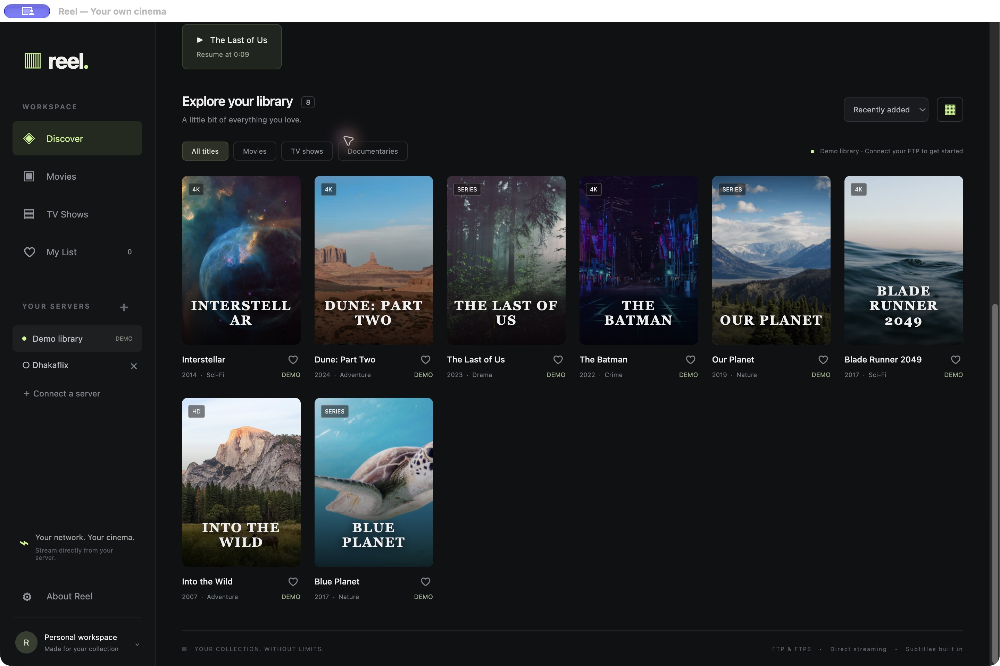

<div align="center">
  
  <h1>Reel</h1>
  <p><strong>Your network. Your collection. Your cinema.</strong></p>
  <p>A minimal desktop player for the media servers on your ISP’s network.<br />Browse folder artwork, stream your collection, and watch with subtitles.</p>
  <p>
    
    
    
  </p>
  <p><a href="#installation">Install</a> · <a href="#connect-your-server">Connect a server</a> · <a href="#watch-and-control-playback">Player</a> · <a href="#subtitles">Subtitles</a> · <a href="#troubleshooting">Troubleshooting</a> · <a href="#development">Development</a></p>
</div>



*The desktop app in demo mode. Titles and artwork are illustrative.*

---

## Meet Reel

Reel turns FTP folders and HTTP directory listings into a visual media library. The standalone app includes its own runtime and streaming service: **you do not need VS Code, Node.js, or a separate backend to use an installer.**

| Feature | What you can do |
| :--- | :--- |
| **Visual browsing** | See artwork from each folder, search the current folder, and sort titles. |
| **Your ISP’s servers** | Add multiple FTP, explicit FTPS, or HTTP/HTTPS servers, including h5ai directories. |
| **Direct streaming** | Start playback without downloading the complete file first; seek when the server and format support it. |
| **Fullscreen** | Use the player button, double-click the video, or press **F**. |
| **Subtitles** | Select server-side SRT/WebVTT files or load subtitles from your computer. |
| **Pick up later** | Keep favorites, playback progress, and server profiles on your device. |

> **Network requirement:** Connect to the Wi-Fi network of the ISP that provides the media server. A private or ISP-only address must be reachable from your current network. Reel does not unlock another ISP’s servers or provide a VPN. Network access is checked by attempting a connection, not by identifying the Wi-Fi name.

## Installation

Download the appropriate installer from [the latest release](https://github.com/iamzakaria/reel/releases/latest). If you are building locally, the files are in the paths below.

| Platform | Release asset | Local build folder |
| :--- | :--- | :--- |
| Windows · Intel / AMD 64-bit | [Reel-0.2.1-win-x64.exe](https://github.com/iamzakaria/reel/releases/download/v0.2.1/Reel-0.2.1-win-x64.exe) | `dist/windows/` |
| macOS · Apple Silicon, M-series | [Reel-0.2.1-mac-arm64.dmg](https://github.com/iamzakaria/reel/releases/download/v0.2.1/Reel-0.2.1-mac-arm64.dmg) | `dist/macos/` |
| macOS · Intel | [Reel-0.2.1-mac-x64.dmg](https://github.com/iamzakaria/reel/releases/download/v0.2.1/Reel-0.2.1-mac-x64.dmg) | `dist/macos/` |
| Linux · Intel / AMD 64-bit | [Reel-0.2.1-linux-x86_64.AppImage](https://github.com/iamzakaria/reel/releases/download/v0.2.1/Reel-0.2.1-linux-x86_64.AppImage) | `dist/linux/` |

### Windows

1. Open the `.exe` installer.
2. Choose the installation folder and complete setup.
3. Launch **Reel** from the Start menu or desktop shortcut.

### macOS

1. Choose the DMG for your Mac’s processor.
2. Open the DMG and drag **Reel** into **Applications**.
3. Launch Reel from Applications. Allow local-network access if macOS requests it so Reel can reach your ISP’s server.

### Linux

Make the AppImage executable using your file manager’s **Permissions** settings, then open it. Alternatively, run these commands from the folder containing the download:

```bash
chmod +x Reel-0.2.1-linux-x86_64.AppImage
./Reel-0.2.1-linux-x86_64.AppImage
```

The AppImage includes the app runtime; compatibility with your distribution’s desktop libraries and AppImage support still applies.

> **Build status:** These are development builds without a verified publisher certificate. The macOS apps are ad-hoc signed but not Apple-notarized; the Windows installer is unsigned. Your operating system may display a publisher warning or block the app. Only install a build you trust. Windows and Linux playback have not yet been validated on those operating systems.

### Updating

Quit Reel before installing a newer version. On macOS, replace the application in Applications; on Windows, run the newer installer; on Linux, replace the AppImage. Keep your application-data folder to retain saved profiles and playback progress. Passwords must be entered again when required.

## Connect your server

1. Connect your computer to the supported ISP’s Wi-Fi.
2. Open Reel and select **Add server**.
3. Give the connection a recognizable name, such as **Home ISP**.
4. Enter the address and any settings supplied by your ISP, then select **Connect server**.

### FTP / FTPS

| Field | What to enter |
| :--- | :--- |
| Server address | A hostname or IP address, such as `192.168.1.10`. Do not include `ftp://`. |
| Port | Usually `21`; use the port supplied by your ISP. |
| Username / password | The supplied credentials. Leave blank for anonymous access if supported. |
| Media folder | `/` for the root, or a path such as `/Movies`. |
| Use secure FTP | Enabled by default for **explicit TLS / FTPS**. Uncheck only when the server uses plain FTP. |

SFTP over SSH and implicit FTPS are not currently supported.

### HTTP / HTTPS media servers

Paste the complete URL, such as `http://192.168.1.10/Movies/`. Reel detects web mode and disables the FTP-only fields. It supports browsable directory listings, including h5ai, and portals linking to media folders on other hosts.

For the DhakaFlix network used during development, the portal address is:

```text
http://172.16.50.12/
```

This is an ISP-local example, **not a public server that everyone can access**. Use the address provided by your own ISP. Websites requiring account login or an interactive web player are not supported by the directory connector.

### Saved servers

Successful connections appear in the sidebar. Select a saved profile to reconnect; enter its password again if required. Select **×** beside a server to forget it. Changing Wi-Fi does not make the previous ISP’s private server accessible—connect to a server supported by the new network.

## Browse your collection

- Open a folder to browse its titles or subfolders; use **Back** to return.
- Search filters the **current folder**, not the entire remote server.
- Use the sort menu and layout toggle to arrange the visible titles.
- Select the heart beside a title to save it. **My List** shows saved titles from the current collection.
- **Continue watching** shows titles in the current collection with saved playback progress.

### Folder artwork

Place artwork inside the media folder. Reel prefers an image named `poster`, `folder`, `cover`, or `fanart` with a `.jpg`, `.jpeg`, `.png`, or `.webp` extension. If none matches, it uses another supported image in that folder. Without an image, it shows a folder tile.

```text
Movies/
└── A Movie (2026)/
    ├── poster.jpg
    ├── A Movie.mp4
    ├── A Movie.en.srt
    └── A Movie.bn.vtt
```

Artwork loads progressively. Large libraries may take time, and HTTP directory listings are cached for approximately 30 seconds.

## Watch and control playback

Select a media file to open the player. Its built-in controls handle playback, seeking, volume, and fullscreen. Server subtitle choices and local subtitle loading are available below the video.

| Action | Control |
| :--- | :--- |
| Enter / exit fullscreen | **Fullscreen** button or **F** while the player is open |
| Toggle fullscreen from the video | Double-click the video |
| Leave fullscreen | **Esc**; playback remains open |
| Close the player | **×** in the player heading after leaving fullscreen |
| Focus library search | **⌘ K** on macOS or **Ctrl K** on Windows / Linux |

The dedicated fullscreen button keeps subtitle controls available. The video’s native fullscreen control is also supported. Keyboard shortcuts do not interrupt typing in input fields.

### Formats and streaming

Playback depends on the codecs supported by Electron/Chromium and the operating system. MP4 with H.264/AAC and WebM are common compatible options. A filename extension alone does not guarantee playback: MKV, HEVC, and other combinations may require conversion outside Reel.

Seeking requires byte-range support from an HTTP server or resume support (`REST`) from an FTP server. MP4 files prepared for fast-start streaming work best. Reel does not currently transcode media.

## Subtitles

**From the server:** Put `.srt` or `.vtt` files in the same folder as the video, then choose a file in the player’s subtitle menu. The menu lists subtitle files in that folder; it does not automatically match their language or filename.

**From your computer:** Choose **Load subtitles** and select an SRT or WebVTT file. SRT timestamps are converted for the player. UTF-8 text is recommended. Choose **Subtitles off** to turn off a selected server track.

Embedded subtitles inside MKV files, ASS/SSA styling, subtitle timing adjustment, and automatic online subtitle downloads are not currently implemented.

## Local data and privacy

The desktop app saves server addresses, usernames, folder paths, favorites, and playback positions in `reel-settings.json` inside the operating system’s application-data directory. **Passwords are kept in memory for the current session and are not written to that file.**

The streaming service listens only on your computer’s loopback interface. Reel contacts the media servers you choose. Demo artwork is loaded from Unsplash; the bundled 15-second silent motion sample plays offline. Demo film names and artwork are illustrative—all demo cards use that same sample, not the named films.

## Troubleshooting

| Problem | What to check |
| :--- | :--- |
| **Cannot connect to an ISP server** | Confirm you are on the correct ISP’s Wi-Fi and that the address is reachable. Check the port, credentials, and FTP/FTPS setting. |
| **An HTTP address fails in FTP mode** | Include `http://` or `https://`; Reel will switch modes automatically. |
| **Connected, but the folder is empty** | Open a media directory or its parent. Unsupported files are hidden, and search or category filters may exclude results. |
| **A title will not play** | Read the displayed connection/decoder error. A reachable file can still use an unsupported codec or be damaged. Try a known compatible MP4 or WebM. |
| **Seeking stalls or fails** | The server may not support ranges/resume, or the file may not be prepared for streaming. |
| **Fullscreen does not open** | Install **0.2.1 or newer**, which fixes the desktop fullscreen permission. Try the dedicated Fullscreen button. |
| **Subtitles do not appear** | Select a subtitle track, check its cue timestamps and encoding, or load a UTF-8 SRT/VTT from your computer. Embedded MKV tracks are not extracted. |
| **Folder pictures are missing** | Check for a supported image inside that folder. Allow time for artwork discovery; refresh after the HTTP cache expires. |
| **A saved server asks for a password again** | This is expected. Reel does not store passwords. |
| **Linux AppImage will not open** | Check the file’s executable permission, use an x86-64 system, and run it from a terminal to see the error. |

When reporting a problem, include your operating system, Reel version, server protocol, file extension, and exact error message. Do not include passwords.

## Development

Use **Node.js 22.12 or newer** and npm. The lockfile records the dependency versions.

```bash
npm ci
npm start
```

A browser preview is also available:

```bash
npm run dev
# Open http://127.0.0.1:4173
```

The desktop app starts its own local service automatically and stores preferences independently of that service’s temporary port.

### Tests

```bash
npm test
npx playwright install chromium
npx playwright test
```

Backend tests cover directory parsing, byte ranges, subtitle conversion, saved settings, and real HTTP/FTP transfers against local fixtures. Browser and Electron tests cover library interactions, offline demo playback, seeking, saved profiles across restarts, and fullscreen controls.

### Build standalone packages

```bash
npm run dist:mac    # Apple Silicon and Intel DMGs; build on macOS
npm run dist:win    # Windows x64 EXE installer
npm run dist:linux  # Linux x64 AppImage
```

All build commands disable publishing. Builds include the required runtime and production dependencies. Cross-building an artifact does not validate its installation or playback on the target operating system.

To regenerate the app icon after editing `build/icon.svg`:

```bash
npm run icons
```

### Project map

```text
desktop/       Electron window, permissions, preload bridge, local settings
src/           Library interface, player, styles, and bundled demo
server.cjs     Local API and FTP streaming bridge
http-media.cjs HTTP directory parsing and streaming proxy
media.cjs      Shared path, range, and subtitle helpers
build/         Installer icon assets
scripts/       Build-support utilities
test/          Backend and persistence tests
e2e/           Browser and desktop tests
```

## Publishing on GitHub

1. Push the source code, lockfile, README, and `build/` assets. The existing `.gitignore` excludes dependencies, generated installers, and test output.
2. Build and verify the release packages. **Do not commit the installers to Git**; upload them as GitHub Release assets.
3. Create a release with a tag matching `package.json`, such as **v0.2.1**.
4. Attach the four platform files listed under Installation and `dist/SHA256SUMS.txt`.
5. Include the signing status and target-platform testing limitations in the release notes. Verify the checksums again if any artifact is rebuilt.

Release **0.2.1** fixes fullscreen permission handling and adds explicit fullscreen controls. For a verified publisher release, configure your own code-signing certificates and macOS notarization credentials before rebuilding. No release or repository is published automatically by this project.

---

<div align="center">
  <sub>Built with <a href="https://www.electronjs.org/">Electron</a>, <a href="https://github.com/patrickjuchli/basic-ftp">basic-ftp</a>, and <a href="https://cheerio.js.org/">Cheerio</a>.</sub>
</div>
